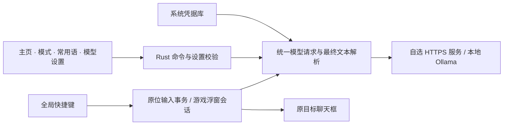

<!--
[INPUT]: 已实现的游戏输入、模型设置、快捷键、原版演示资源与本机/正式交付配置。
[OUTPUT]: 中文产品首页，提供下载、真实使用流程、架构与开发入口；英文入口为 docs/README.en.md。
[POS]: 仓库公开入口，将游戏内翻译定位、平台能力、数据边界与源码地图连接起来。
[PROTOCOL]: 变更时更新此头部，然后检查 CLAUDE.md
-->
<div align="center">
  
  <h1>DeepRant · 鲸喷</h1>
  <p><strong>在国际服游戏里，用你的语言写，用玩家的语言说。</strong></p>
  <p>游戏内翻译 · 输入浮窗 · 游戏术语 · 自选模型</p>
  <p>
    <a href="https://github.com/liseami/DeepRant/releases"></a>
    
    
    
    
  </p>
  <p><strong>简体中文</strong> · <a href="docs/README.en.md">English</a></p>
  <p>
    <a href="#功能">功能</a> ·
    <a href="#下载安装">下载安装</a> ·
    <a href="#快速开始">快速开始</a> ·
    <a href="#模型与-api">模型与 API</a> ·
    <a href="#架构">架构</a> ·
    <a href="#开发">开发</a> ·
    <a href="#数据与权限">数据与权限</a>
  </p>
</div>


<p align="center"><a href="src/assets/demovideo.mp4">观看原版游戏录屏</a> · 以上为保留的原版演示资源，并非 2.0 新界面截图。</p>

DeepRant 是桌面游戏聊天翻译工具。准备好语言、场景与表达风格，按全局快捷键即可翻译：可复制的聊天框走原位替换；无法复制的聊天框通过独立输入浮窗写消息、查看译文，再确认回填。发送始终由你自己完成。

2.0 保留主页演示横幅和语言、场景、快捷键三张卡，采用与 [CCBaga](https://github.com/liseami/CCBaga) 同源的 **Cromma UI / Laper App 组件、Pika 图标与动效**。界面默认中文，可在侧栏切换 English；界面语言与翻译方向独立。

> [!NOTE]
> **本分支的 2.0 正在整合与本机验收，尚未公开发布。** 下载页显示的是已经发布的版本；本文说明当前源码实现，历史安装包可能没有这些新功能。

## 功能

<table>
  <tr>
    <td width="33%"><strong>游戏内原位翻译</strong><br /><br />打开聊天框、写原文、按快捷键。复制成功后才请求模型，回填前再次核对焦点与原文，失败保留输入。</td>
    <td width="33%"><strong>独立游戏输入浮窗</strong><br /><br />在空聊天框触发热键，浮窗里写消息、翻译、修改译文，再确认回填原游戏。不依赖聊天框复制，不自动发送。</td>
    <td width="33%"><strong>游戏语境与术语</strong><br /><br />LoL、Dota 2、CS2、Valorant 等预设语境，加上自定义场景与术语对照表，表达贴近当前游戏。</td>
  </tr>
  <tr>
    <td><strong>统一表达风格</strong><br /><br />嘴臭、职业玩家、自动三种模式；通用提示词适用于游戏和日常。支持同语言润色及英式、东南亚英语变体。</td>
    <td><strong>你的模型，你的 Key</strong><br /><br />DeepSeek、OpenAI 兼容、Anthropic Messages、腾讯 TokenHub、硅基流动、302.AI，或无需 Key 的本地 Ollama。</td>
    <td><strong>可配置常用语</strong><br /><br />新增、编辑、删除短语，配置逐条快捷键与开关。整体启用默认关闭；冲突和系统注册失败会回滚。</td>
  </tr>
</table>

**一个准备页面，两条输入路径。** 主页选语言、游戏和输入方式；模式页设置表达；常用语管理重复消息；AI 模型页保存配置并测试连接。关于页与托盘提供版本和更新入口，不需要注册 DeepRant 账号。

原版录屏随应用打包，通过限定单文件的原生资源协议按需读取。首页播放器切页保留，离页、隐藏窗口或离开视口时暂停；首帧显示原预览图，避免切页重新加载整段录屏。

## 下载安装

从 **[GitHub Releases](https://github.com/liseami/DeepRant/releases)** 下载对应平台。正式版本由项目所有者 **liseami** 发布。以下是 2.0 交付命名约定；未发布前请以下载页实际存在的资产为准。

| 平台 | 安装包 | 安装方式 |
| --- | --- | --- |
| macOS 12+ · Apple Silicon | `DeepRant-<version>-macos-arm64.dmg` | 打开 DMG，将 `DeepRant.app` 拖到 Applications |
| macOS 12+ · Intel | `DeepRant-<version>-macos-x64.dmg` | 使用 Intel 包，拖到 Applications |
| Windows 10/11 · x86_64 | `DeepRant-<version>-windows-x86_64-setup.exe` | 运行当前用户 NSIS 安装器 |

本版本发布目标是上述桌面平台；没有移动客户端或 Linux 安装包。游戏场景名单描述翻译语境，包含的移动游戏名称不代表支持手机输入。

### macOS

1. 按芯片类型选择 DMG 并安装到 Applications。
2. 打开 DeepRant，在 **系统设置 → 隐私与安全性 → 辅助功能** 中允许应用输入。
3. 到 **AI 模型** 配置服务，再到主页设置语言和快捷键。

正式交付流程使用与 CCBaga 相同的 Developer ID 团队，完成签名、公证与票据装订。本机开发包使用临时签名，属于开发交付，不等同于正式下载。

### Windows

安装器使用当前用户目录。原生输入不调用 PowerShell，无需改变执行策略。DeepRant 与目标游戏的权限级别需要兼容，优先让两者以普通用户运行。

更新包签名验证与 Windows Authenticode 代码签名是不同机制；当前安装器未配置 Authenticode 证书，系统信誉提示可能出现。游戏输入是否接受模拟按键需要在具体游戏环境验收。

## 快速开始

### 先准备语言和模型

1. 打开 **AI 模型**，选择供应商或自定义协议、地址与模型名。
2. 云服务填自己的 API Key，点击 **保存并测试连接**；本地 Ollama 无需 Key。
3. 在 **主页** 选择翻译方向、游戏场景与快捷键。初始默认使用 Dota 2 语境，按实际游戏调整。
4. 在 **模式** 选择自动、职业玩家或嘴臭表达；需要的话填写通用提示词。

不要将界面语言当作翻译方向：选择中文界面，也可以把韩文翻成英文。源语言与目标语言相同则在同语言内润色。

### LoL 与无法复制的聊天框

主页的输入方式默认是 **自动**。选择 **英雄联盟** 游戏场景且处于游戏模式时，自动方式使用输入浮窗；其他场景也可以主动选择 **游戏输入浮窗**。

1. 在游戏里打开一个**空聊天框**，让它获得输入焦点。
2. 按翻译快捷键，DeepRant 打开独立浮窗并记录原目标窗口。
3. 在浮窗写原文，点击 **翻译**，查看并编辑译文。
4. 点击 **回填聊天框**，应用恢复原目标并通过原生 Unicode 输入填入文本。
5. 返回游戏后检查内容，自己按 Enter 发送。

浮窗中 `Ctrl / ⌘ + Enter` 可翻译或回填，`Esc` 取消。重复热键会回到当前会话；回填失败会保留草稿。浮窗不读取已经写在游戏里的内容，所以请从空聊天框开始。

### 可复制聊天框的原位翻译

选择 **原位翻译**，或在非 LoL 游戏场景保留自动方式：

1. 打开游戏聊天框，输入原文。
2. 按快捷键。应用等待修饰键释放，全选并复制原文，再调用模型。
3. 只有原目标、焦点和原文仍符合条件，才粘贴结果。
4. 检查译文后自行发送。

日常模式使用你已经选中的文字，不全选整个输入框。没有复制到新文本、重复触发、焦点离开或原文变化时会取消操作；进度和错误只显示在 DeepRant，不写进聊天。

### 场景、风格和常用语

- **场景**：LoL、Dota 2、CS2、Valorant、守望先锋、漫威争锋、风暴英雄、彩虹六号、Apex、PUBG、永劫无间、战舰世界、坦克世界、星际公民、全境封锁 2、梦三国、燕云十六声、王者荣耀、Fortnite、Minecraft、Warzone、魔兽世界，也可自填场景说明。
- **术语表**：在主页维护你使用的英雄、技能、装备和地点叫法；语言变体不用于猜测对方的国籍、地区或身份。
- **通用提示词**：在模式页写表达偏好，所有输入方式共用；日常专业模式使用简洁表达，不凭空加入游戏术语。
- **常用语**：在常用语页编辑内容、按键和每条开关，再明确开启整体开关。普通键需要修饰键，F1–F24 和小键盘数字可单键绑定；小键盘数字需要 NumLock。Windows 不允许无法独立区分的小键盘 Enter / Equal 别名。

受限输入框仍可使用模式页的 **辅助翻译**，将结果复制后自行粘贴。场景预设与输入路径实现不代表所有游戏都已现场验证；应用不修改游戏文件、不注入游戏进程，也不绕过反作弊。连续聊天频道识别、OCR 和移动端翻译不在本版本范围。

## 模型与 API

| 配置 | 协议与用途 |
| --- | --- |
| DeepSeek Flash / Pro | 官方服务预设，使用自己的 Key；预设模型 ID 为 `deepseek-flash` / `deepseek-v4-pro` |
| OpenAI / 自定义兼容服务 | 官方轻量预设为 `gpt-6-luna`；使用 Chat Completions，地址可以是服务根地址、`/v1` 或完整 `/chat/completions` |
| Anthropic | Messages 协议；填写匹配的服务地址与模型 ID |
| 腾讯 TokenHub · 广州 / 新加坡 | 独立区域预设；两种端点使用各自凭据 |
| 硅基流动 / 302.AI | 可编辑的兼容服务预设，模型可用性及额度由供应商决定 |
| Ollama · Qwen3.5 4B | 默认 `http://localhost:11434/v1` 与 `qwen3.5:4b`，模型名须与本机已安装模型一致，无需 Key；也可改用自己的本地模型 |

所有预设都可编辑；地址、模型 ID 和权限须与供应商实际账户匹配。远程服务要求 HTTPS，HTTP 只允许本机回环地址。选择协议后由后端归一最终端点，连接测试和翻译使用同一请求管道。

推理模型可按服务能力开启通用推理兼容参数，使用 120 秒超时与 16,384 token 输出预算，为思考与最终回答留空间；普通配置使用 2,048 token 预算、60 秒超时。OpenAI 官方轻量预设默认关闭思考，开启兼容时使用低推理强度；其他兼容服务按对应协议处理，不将该选项绑定某一代模型。应用只接受最终文本，不把 `reasoning_content` 或 `<think>` 内容当作译文，也不把截断结果自动填入游戏。

测试连接后可以复制安全诊断：服务名、协议、模型、耗时与脱敏结果。诊断不含 Key 或服务端原始响应。保存时空 Key 保留已有凭据；要移除凭据，使用明确的删除操作。

## 更新

在 **关于** 或系统托盘选择 **检查更新**。确认版本后，只有点击安装操作才下载并安装；过程显示实际进度，完成后重启。

正式更新验证签名与公告版本绑定。发布产物包含对应平台安装器、更新归档和 `SHA256SUMS`；macOS 两种架构与 Windows 安装验收全部通过，才公开同一版本。2.0 发布前，应用更新入口仍读取已经公开的发布渠道。

## 架构



界面负责输入、预览和结果展示。Rust 负责设置校验与原子写入、系统凭据、快捷键注册、模型请求、目标身份和输入事务。两条输入路径共用模型、场景、风格与术语，不各自实现一套请求或配置。

| 层 | 技术 | 职责 |
| --- | --- | --- |
| 桌面宿主 | Rust · Tauri 2 | 原生命令、窗口、托盘、事务锁和生命周期 |
| 界面 | React 19 · Cromma UI / Laper App · Pika | 游戏准备、浮窗草稿、模式和诊断展示 |
| 原生输入 | enigo · macOS / Windows API | 快捷键释放、焦点与目标确认、Unicode 输入和剪贴板恢复 |
| 模型边界 | reqwest · OpenAI / Anthropic 协议 | 超时、端点归一、响应限制、最终文本提取 |
| 持久化 | 原子 JSON · 系统凭据库 | 公开设置与秘密分离，旧配置验证迁移 |
| 交付 | Python 标准库 · Tauri updater · GitHub Actions | 本机安装、最终字节签名、平台验收和发布汇总 |

<details>
<summary><strong>仓库地图</strong></summary>

```text
src/pages/           主页、模式、常用语、模型、关于与游戏输入浮窗
src/components/      侧栏、设置缓存、快捷键录制、更新与通知
src/data/            语言、场景、供应商预设和中英文文案
src/assets/          保留的录屏与预览、压缩品牌图、媒体校验清单
src-tauri/src/       设置、凭据、模型与原生输入的唯一执行边界
src-tauri/icons/     从根目录品牌源图派生的原生安装图标
vendor/cromma-ui/    CCBaga 同源组件、Laper App 主题与 Pika 图标
scripts/             图标生成、本机安装、平台打包与交付验证
.github/workflows/   普通检查与独立的 release 发布工作流
docs/                中英文产品文档与 issue / PR 覆盖记录
```

`CLAUDE.md` 记录模块职责，源码头部记录输入、输出与边界。完整问题归类见 [issue / PR 覆盖记录](docs/issues.md)。构建产物、安装包与私人凭据不进入源码仓库。

</details>

## 开发

### 环境

需要 Node.js 22.12+、npm、Python 3；仓库固定 Rust 1.98.1。macOS 需要 Xcode Command Line Tools；Windows 需要 MSVC 桌面 C++ 工具链与 WebView2。原生工具链准备参考 [Tauri prerequisites](https://v2.tauri.app/start/prerequisites/)。

```sh
npm ci
npm run tauri dev
```

### 快速本机打包与安装（macOS Apple Silicon）

```sh
npm run dev:install
```

在 `release` 分支运行本机交付：重新构建内嵌界面的 debug 应用，使用系统钥匙串里的同团队 Developer ID 稳定签名，事务替换 `/Applications/DeepRant.app` 并启动。没有证书时回退临时签名；不会读取公证或更新私钥，不自动发布。稳定签名避免每次编译改变辅助功能的授权身份。

每次生成 `releases/DeepRant-<version>-local-arm64-<commit>.app.zip` 与 `releases/local-build.json`，记录源码 commit、时间与 SHA-256。技术检查由整合方完成，界面和实际游戏行为需要在目标环境验收。本机开发包不是正式发行包。

### 检查

```sh
npm run check
python3 scripts/test-release.py
rustup run 1.98.1 cargo fmt --manifest-path src-tauri/Cargo.toml --check
rustup run 1.98.1 cargo test --locked --manifest-path src-tauri/Cargo.toml --features custom-protocol
rustup run 1.98.1 cargo clippy --locked --manifest-path src-tauri/Cargo.toml --all-targets --features custom-protocol -- -D warnings
```

普通 PR 检查覆盖 macOS / Windows 前端、原生测试与静态检查，不接触签名凭据。release 分支由所有者触发，独立验证后生成最终安装器并汇总发布；流程见 [release.yml](.github/workflows/release.yml)。生产构建使用 `custom-protocol` 加载随包界面，不依赖开发服务器。

自动检查验证设置、响应解析、会话边界与媒体保留；它们不等于在真实游戏中进行焦点、权限、全屏模式或反作弊兼容验收。

## 数据与权限

- **Key 留在系统凭据库。** macOS 使用钥匙串，Windows 使用系统凭据设施，以协议和最终端点隔离。界面保存后只获得“已保存”状态，不读回密钥。
- **旧设置先验证再迁移。** 缺失字段使用默认值，损坏的 `store.json` 不被自动覆盖。旧明文 Key 经验证、写入与读回确认后才移除；迁移冲突保留原文件。
- **文本去往你选的服务。** 云模型收到待翻译内容；选择本地 Ollama 时请求发往本机服务。服务费用和数据处理条款由供应商决定。
- **应用没有账号、订阅或遥测。** 不提供内置共享 Key；更新检查访问公开 GitHub 发布渠道。
- **原位输入会使用剪贴板。** 事务恢复文本、图片或空剪贴板；富文本恢复为纯文本，无法安全恢复的其他格式会拒绝自动操作。浮窗回填使用原生输入，主动点击复制译文则改写剪贴板。
- **权限只服务输入。** macOS 输入需要辅助功能许可；Windows 目标与应用需要兼容权限级别。无需关闭安全软件或更改 PowerShell 执行策略。

历史源码曾公开的共享 Key，删除现行代码无法使其失效；持有人需要在供应商后台撤销。当前仓库不宣称已经代为完成撤销。

## 反馈与贡献

提交 [Issue](https://github.com/liseami/DeepRant/issues) 时，请提供系统、应用版本、游戏及输入方式、复现步骤和脱敏诊断。不要附 API Key、私人聊天记录或完整配置文件。

小范围、职责明确的改动更容易审查。先读 [架构地图](CLAUDE.md) 与 [问题覆盖记录](docs/issues.md)，修改行为时同步模块地图和源码契约，并附相关技术检查结果。

## 致谢

基于 [Tauri](https://tauri.app/)、[React](https://react.dev/) 与 [enigo](https://github.com/enigo-rs/enigo)。组件、主题和 Pika 图标体系沿用作者的 [CCBaga](https://github.com/liseami/CCBaga) 项目。第三方依赖保留各自许可，游戏及模型品牌属于其权利人。

<div align="center"><sub>独立项目，与游戏发行商、模型供应商或 Apple 没有隶属及背书关系。</sub></div>
