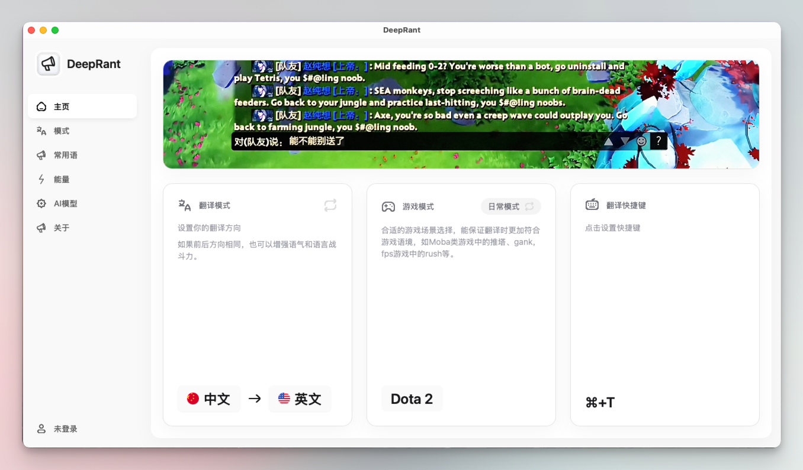

<!--
[INPUT]: 游戏输入、模型配置、设置持久化、原版演示资源与交付入口。
[OUTPUT]: 中文产品入口：插图、下载、游戏使用步骤与开发导航；英文入口为 docs/README.en.md。
[POS]: 面向玩家的简明首页，技术实现与需求记录转交 CLAUDE.md 和 docs/issues.md。
[PROTOCOL]: 变更时更新此头部，然后检查 CLAUDE.md
-->
<div align="center">
  
  <h1>DeepRant · 鲸喷</h1>
  <p><strong>用你的语言写，用玩家的语言说。</strong></p>
  <p>游戏内翻译 · 游戏术语 · 自选模型</p>
  <p>
    <a href="https://github.com/liseami/DeepRant/releases/latest"></a>
    
    
  </p>
  <p><strong>简体中文</strong> · <a href="docs/README.en.md">English</a></p>
  <p><a href="#下载安装">下载</a> · <a href="#开始翻译">开始翻译</a> · <a href="#开发">开发</a></p>
</div>

[](src/assets/demovideo.mp4)

<p align="center"><a href="src/assets/demovideo.mp4">▶ 观看 / 下载原版游戏录屏</a> · 保留原版演示，当前界面采用 CCBaga 同款 Laper App 与 Pika。</p>

## 下载安装

**[打开最新发布页](https://github.com/liseami/DeepRant/releases/latest)**，选择对应平台；版本和安装包以该页实际资产为准。本文介绍当前源码能力。

| 平台 | 下载入口 | 安装 |
| --- | --- | --- |
| macOS 12+ · Apple Silicon | [ARM64 / aarch64 DMG](https://github.com/liseami/DeepRant/releases/latest) | 将 `DeepRant.app` 拖到 Applications |
| macOS 12+ · Intel | [x64 DMG](https://github.com/liseami/DeepRant/releases/latest) | 将 `DeepRant.app` 拖到 Applications |
| Windows 10/11 · x86_64 | [Windows 安装器](https://github.com/liseami/DeepRant/releases/latest) | 运行安装程序 |

应用内在 **关于 → 检查更新** 查看版本，确认后下载、安装并重启。

## 开始翻译

1. **填写 Key**：没有 DeepSeek Key 时，应用顶部横幅可直接填写、保存，并直达 [DeepSeek 开放平台](https://platform.deepseek.com/)。在 AI 模型页可查看、显隐和修改自己的 Key。
2. **允许输入**：macOS 点击应用中的 **打开辅助功能设置**，允许 DeepRant；Windows 让应用与游戏使用相同权限级别。
3. **准备游戏**：主页选择翻译方向、游戏场景与快捷键；在模式页选择自动、职业玩家或嘴臭表达。
4. **触发翻译**：打开游戏聊天框，写好原文，将光标放到末尾，按翻译快捷键（macOS 默认 `⌘ + T`）。原位输入显示 **翻译中...**，完成后换成译文；请求失败且输入未改动时恢复原文。
5. **自己发送**：检查译文，再按 Enter。DeepRant 不替你发送消息。

| 输入方式 | 怎么用 |
| --- | --- |
| **原位翻译** | 用于可复制的聊天框。向前选中当前行、复制、写入占位，再核对焦点与占位后替换；你新写的内容不会被覆盖。 |
| **游戏输入浮窗** | 用于无法复制的聊天框；LoL 的自动方式默认走这条路径。先打开空聊天框，触发热键，在浮窗写消息、翻译、编辑并确认回填。 |
| **日常模式** | 翻译已经选中的文字；在 Pages 等文档应用里先选中要翻译的部分。 |

浮窗支持 `Ctrl / ⌘ + Enter` 翻译或回填，`Esc` 取消。输入受限时，也可在模式页辅助翻译并手动复制结果。

## 按你的习惯设置

- **游戏语境**：LoL、Dota 2、CS2、Valorant 等预设，支持自定义场景、术语表与通用提示词。
- **语言与风格**：双向翻译、同语言润色、英式与东南亚英语；界面中文 / English 独立切换。
- **模型自由**：DeepSeek、OpenAI 兼容服务、Anthropic、腾讯 TokenHub、硅基流动、302.AI，或无需 Key 的本地 Ollama。
- **常用语**：新增、编辑、删除短语，配置每条快捷键和开关；支持小键盘数字与功能键。

Rust 负责翻译、快捷键、剪贴板与系统交互；界面负责输入和展示。全部设置保存在本机 SQLite，旧配置自动迁移；Key 保存在系统凭据库，查看时只交给当前模型编辑界面，不写进数据库或日志。翻译请求只发送给你选择的模型服务。

## 开发

Node.js 22.12+、Python 3、仓库固定 Rust 工具链；先准备 [Tauri 原生环境](https://v2.tauri.app/start/prerequisites/)。

```sh
npm ci
npm run tauri dev
```

macOS Apple Silicon 在 `release` 分支运行 `npm run dev:install`：重新打包、替换并启动 `/Applications/DeepRant.app`，交付归档保存在 `releases/`。本机安装不自动发布；正式打包由 [release 工作流](.github/workflows/release.yml) 负责。

[模块地图](CLAUDE.md) · [需求与验收记录](docs/issues.md) · [反馈问题](https://github.com/liseami/DeepRant/issues)

基于 [Rust / Tauri](https://tauri.app/)、[React](https://react.dev/) 与 [enigo](https://github.com/enigo-rs/enigo)。组件、Laper App 主题和 Pika 图标来自作者的 [CCBaga](https://github.com/liseami/CCBaga)。
