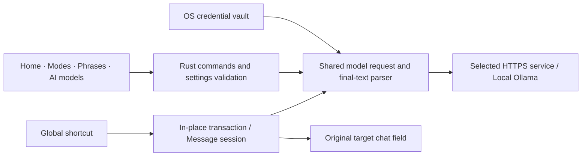

<!--
[INPUT]: 已实现的游戏输入、模型设置、快捷键、原版演示资源与本机/正式交付配置。
[OUTPUT]: 与根 README 等价的独立英文产品首页、下载及开发说明。
[POS]: 中文公开入口的英文版本，使用同一能力边界与仓库资源，不宣称未发布版本已经交付。
[PROTOCOL]: 变更时更新此头部，然后检查 CLAUDE.md
-->
<div align="center">
  
  <h1>DeepRant</h1>
  <p><strong>Write in your language. Speak the language of your game.</strong></p>
  <p>In-game translation · Message window · Game terminology · Your own model</p>
  <p>
    <a href="https://github.com/liseami/DeepRant/releases"></a>
    
    
    
    
  </p>
  <p><a href="../README.md">简体中文</a> · <strong>English</strong></p>
  <p>
    <a href="#features">Features</a> ·
    <a href="#installation">Installation</a> ·
    <a href="#quick-start">Quick start</a> ·
    <a href="#models--apis">Models &amp; APIs</a> ·
    <a href="#architecture">Architecture</a> ·
    <a href="#development">Development</a> ·
    <a href="#data--permissions">Data &amp; permissions</a>
  </p>
</div>


<p align="center"><a href="../src/assets/demovideo.mp4">Watch the original game recording</a> · These preserved demo assets show the original app, not a new 2.0 screenshot.</p>

DeepRant translates desktop game chat. Choose languages, context and tone, then press a global shortcut. Copyable chat fields use translation in place; fields that cannot be copied use a separate message window where you write, translate, review and confirm insertion. You always send the message yourself.

Version 2.0 keeps the demo banner and three Home cards for languages, context and shortcuts. It uses the same **Cromma UI / Laper App components, Pika icons and motion** as [CCBaga](https://github.com/liseami/CCBaga). The interface defaults to Chinese; switch to English in the sidebar. Interface language and translation direction are independent.

> [!NOTE]
> **Version 2.0 in this branch is undergoing integration and local acceptance. It has not been publicly released.** The downloads page contains existing releases; this document describes the current source, whose new features may be absent from older installers.

## Features

<table>
  <tr>
    <td width="33%"><strong>Translate inside game chat</strong><br /><br />Open chat, write and press your shortcut. The model runs only after a successful copy; focus and source text are checked again before replacement. Failures preserve your input.</td>
    <td width="33%"><strong>Separate message window</strong><br /><br />Trigger the shortcut from an empty chat field. Write, translate and edit in a separate window, then confirm insertion into the original game. Copying from game chat is unnecessary; messages are never sent automatically.</td>
    <td width="33%"><strong>Game context &amp; terminology</strong><br /><br />Presets for LoL, Dota 2, CS2, Valorant and other games combine with your custom context and glossary.</td>
  </tr>
  <tr>
    <td><strong>Consistent tone</strong><br /><br />Trash talk, Pro player and Automatic modes; custom instructions apply to games and everyday chat. Includes same-language rewriting and UK/Southeast Asian English variants.</td>
    <td><strong>Your model, your key</strong><br /><br />DeepSeek, OpenAI-compatible services, Anthropic Messages, Tencent TokenHub, SiliconFlow and 302.AI, or local Ollama without an API key.</td>
    <td><strong>Editable phrase shortcuts</strong><br /><br />Add, edit and remove phrases with individual shortcuts and switches. The global switch starts off. Conflicts and registration failures roll back.</td>
  </tr>
</table>

**One preparation page. Two input workflows.** Home sets languages, game and input method; Modes sets tone; Phrases manages repeated messages; AI models saves configuration and tests connections. About and the tray provide version and update actions. No DeepRant account is required.

The original recording ships with the application. A native resource protocol restricted to that file reads it on demand. Home retains its player across navigation and pauses it when off-page, hidden or outside the viewport. The original preview appears before playback, avoiding a full video reload whenever you switch pages.

## Installation

Download from **[GitHub Releases](https://github.com/liseami/DeepRant/releases)**. Official versions are published by the project owner, **liseami**. The following names are the 2.0 delivery convention; until publication, use assets that actually exist on the releases page.

| Platform | Installer | Installation |
| --- | --- | --- |
| macOS 12+ · Apple Silicon | `DeepRant-<version>-macos-arm64.dmg` | Open the DMG and drag `DeepRant.app` into Applications |
| macOS 12+ · Intel | `DeepRant-<version>-macos-x64.dmg` | Choose the Intel package and drag it into Applications |
| Windows 10/11 · x86_64 | `DeepRant-<version>-windows-x86_64-setup.exe` | Run the current-user NSIS installer |

These desktop platforms are the release targets. This version has no mobile client or Linux package. Game presets describe translation context; mobile game names in the list do not imply phone input support.

### macOS

1. Choose the DMG for your processor and install into Applications.
2. Open DeepRant and allow it in **System Settings → Privacy & Security → Accessibility**.
3. Configure a service in **AI models**, then choose languages and a shortcut on Home.

Official delivery uses the same Developer ID team as CCBaga, signing, notarization and stapled tickets. Local builds prefer that team's stable signature to preserve their input-permission identity; public downloads also undergo full notarization checks.

### Windows

The installer uses a current-user directory. Native input does not invoke PowerShell or require an execution-policy change. DeepRant and the target game need compatible privilege levels; prefer running both as ordinary users.

Updater signatures and Windows Authenticode are separate mechanisms. The installer currently has no configured Authenticode certificate, so reputation prompts may appear. Acceptance of simulated input requires validation in the particular game environment.

## Quick start

### Prepare your languages and model

1. Open **AI models** and select a provider, or enter a custom protocol, endpoint and model name.
2. Enter your own API key for cloud services and choose **Save and test connection**. Local Ollama needs no key.
3. On **Home**, select translation direction, game context and shortcut. The initial default context is Dota 2; change it to match your game.
4. In **Modes**, choose Automatic, Pro player or Trash talk. Add custom instructions if desired.

Interface language does not set translation direction: a Chinese interface can translate Korean into English. Choosing the same source and target language rewrites text within that language.

### LoL and chat fields that cannot be copied

The input method defaults to **Automatic**. Selecting **League of Legends** in game mode routes Automatic input through the message window. You can also explicitly select **In-game message window** for another context.

1. Open an **empty chat field** in your game and focus it.
2. Press your translation shortcut. DeepRant opens a separate window and records the original target window.
3. Write the source message, choose **Translate**, then review and edit the result.
4. Choose **Insert into game**. The app restores the original target and inserts text using native Unicode input.
5. Check the text in game and press Enter yourself to send it.

In the message window, `Ctrl / ⌘ + Enter` translates or inserts; `Esc` cancels. Repeating the shortcut returns to the current session. Failed insertion retains the draft. The message window does not read text already inside the game, so start from an empty chat field.

### Translate in a copyable chat field

Choose **Translate inside the chat field**, or leave Automatic selected for a non-LoL game context:

1. Open game chat and write your source text.
2. Press the shortcut. The app waits for modifiers to be released, selects and copies the text, then requests a translation.
3. It pastes only when the original target, focus and source text still satisfy the checks.
4. Review the result and send it yourself.

Everyday mode uses text you have already selected instead of selecting the entire field. A failed copy, repeated trigger, changed focus or edited source cancels the operation. Progress and errors appear inside DeepRant and are never inserted into chat.

### Context, tone and phrases

- **Contexts:** LoL, Dota 2, CS2, Valorant, Overwatch, Marvel Rivals, Heroes of the Storm, Rainbow Six Siege, Apex, PUBG, Naraka: Bladepoint, World of Warships, World of Tanks, Star Citizen, The Division 2, Dream Three Kingdoms, Where Winds Meet, Honor of Kings, Fortnite, Minecraft, Warzone and World of Warcraft, plus custom context descriptions.
- **Glossary:** maintain names for heroes, skills, equipment and locations on Home. Language variants are not used to guess another player's nationality, region or identity.
- **Custom instructions:** describe your preferences in Modes. Every input workflow shares them; the everyday professional mode keeps language concise without inventing game jargon.
- **Phrases:** edit content, shortcuts and individual switches, then explicitly enable the global switch. Ordinary keys require modifiers. F1–F24 and numpad digits may be bound alone; numpad digits need NumLock. Windows rejects numpad Enter / Equal aliases that cannot be registered distinctly.

Restricted fields can still use **Auxiliary translation** in Modes; copy the result and paste it yourself. Context presets and implemented input paths do not mean every game has been tested live. The app does not modify game files, inject into game processes or bypass anti-cheat. Continuous chat-channel recognition, OCR and mobile translation are outside this version's scope.

## Models & APIs

| Configuration | Protocol and purpose |
| --- | --- |
| DeepSeek Flash / Pro | Official service presets using your own key; preset IDs are `deepseek-flash` / `deepseek-v4-pro` |
| OpenAI / custom compatible service | The official lightweight preset uses `gpt-6-luna` with Chat Completions; enter a service root, `/v1`, or a complete `/chat/completions` endpoint |
| Anthropic | Messages protocol with a matching endpoint and model ID |
| Tencent TokenHub · Guangzhou / Singapore | Separate regional presets with credentials for each endpoint |
| SiliconFlow / 302.AI | Editable compatible-service presets; model availability and quotas are provider-managed |
| Ollama · Qwen3.5 4B | Defaults to `http://localhost:11434/v1` and `qwen3.5:4b`. Match a locally installed model or choose your own. No API key required |

Every preset is editable. Endpoint, model ID and access must match your provider account. Remote services require HTTPS; HTTP is accepted only for local loopback addresses. Rust normalizes the final endpoint for the chosen protocol. Connection testing and translation use the same request pipeline.

Reasoning models can use the general reasoning compatibility option when supported by their service. It allows 120 seconds and 16,384 output tokens for reasoning and the final answer; ordinary requests use 2,048 tokens and a 60-second timeout. The official lightweight OpenAI preset disables reasoning by default and uses low effort when compatibility is enabled. Other compatible services follow their respective protocols; the option is not tied to one model generation. Only final text is accepted. `reasoning_content` and `<think>` content are not used as translations, and truncated results are not automatically inserted into game chat.

After testing a connection, copy a safe diagnostic containing server, protocol, model, elapsed time and a sanitized result. It contains no API key or raw server response. Leaving the key draft empty preserves existing credentials; use the explicit delete action to remove them.

## Updates

Choose **Check for updates** in **About** or the system tray. Review the version; downloading and installation start only after the install action. The app shows actual progress and restarts on completion.

Official updates verify signatures bound to the advertised version. Release artifacts include platform installers, update archives and `SHA256SUMS`. Both macOS architectures and Windows installation acceptance must pass before the same version is published. Until 2.0 is released, the update action continues to read the existing public release channel.

## Architecture



The interface owns inputs, previews and presentation. Rust owns settings validation and atomic persistence, system credentials, shortcut registration, model requests, target identity and input transactions. Both input paths share models, context, tone and glossary instead of maintaining separate request or configuration systems.

| Layer | Technology | Responsibility |
| --- | --- | --- |
| Desktop host | Rust · Tauri 2 | Native commands, windows, tray, transaction locks and lifecycle |
| Interface | React 19 · Cromma UI / Laper App · Pika | Game preparation, message drafts, modes and diagnostics |
| Native input | enigo · macOS / Windows APIs | Modifier release, target/focus checks, Unicode input and clipboard restoration |
| Model boundary | reqwest · OpenAI / Anthropic protocols | Timeouts, endpoint normalization, response limits and final-text extraction |
| Persistence | Atomic JSON · OS credential vault | Public settings separated from secrets, validated legacy migration |
| Delivery | Python standard library · Tauri updater · GitHub Actions | Local installation, final-byte signatures, platform acceptance and release assembly |

<details>
<summary><strong>Repository map</strong></summary>

```text
src/pages/           Home, Modes, Phrases, AI models, About and message window
src/components/      Sidebar, settings cache, shortcut recorder, updates and status
src/data/            Languages, contexts, provider presets and bilingual text
src/assets/          Preserved video/preview, compressed brand art and media hashes
src-tauri/src/       Execution boundary for settings, secrets, models and native input
src-tauri/icons/     Native icons derived from the root brand source image
vendor/cromma-ui/    CCBaga components, Laper App theme and Pika icons
scripts/             Icons, local installation, platform packaging and delivery checks
.github/workflows/   Ordinary checks and a separate release workflow
docs/                Product documentation and issue / PR coverage
```

`CLAUDE.md` maps module responsibilities; source headers describe inputs, outputs and boundaries. See the [issue / PR coverage record](issues.md) for requirement classification. Build outputs, installers and private credentials stay out of the source repository.

</details>

## Development

### Prerequisites

Use Node.js 22.12+, npm and Python 3. The repository pins Rust 1.98.1. macOS requires Xcode Command Line Tools; Windows requires the MSVC desktop C++ toolchain and WebView2. See [Tauri prerequisites](https://v2.tauri.app/start/prerequisites/) for native toolchain setup.

```sh
npm ci
npm run tauri dev
```

### Fast local build and install (macOS Apple Silicon)

```sh
npm run dev:install
```

Run local delivery from the `release` branch. It rebuilds a debug application with its UI embedded, prefers the same team's Developer ID in the system Keychain, transactionally replaces `/Applications/DeepRant.app` and starts it. Without a certificate it falls back to ad-hoc signing. Settings are preserved; notarization and updater secrets are not exported, and the command publishes nothing. A stable signature prevents each rebuild from changing the application's Accessibility identity.

Each invocation creates `releases/DeepRant-<version>-local-arm64-<commit>.app.zip` and `releases/local-build.json`, recording the source commit, time and SHA-256. The integrator performs technical checks; interface and actual game behavior require acceptance in the target environment. Development packages are distinct from official releases.

### Checks

```sh
npm run check
python3 scripts/test-release.py
rustup run 1.98.1 cargo fmt --manifest-path src-tauri/Cargo.toml --check
rustup run 1.98.1 cargo test --locked --manifest-path src-tauri/Cargo.toml --features custom-protocol
rustup run 1.98.1 cargo clippy --locked --manifest-path src-tauri/Cargo.toml --all-targets --features custom-protocol -- -D warnings
```

Ordinary PR checks cover macOS / Windows frontend, native tests and static checks without signing credentials. The owner triggers the release branch workflow, which validates independently, generates final installers and assembles the release. See [release.yml](../.github/workflows/release.yml). Production builds use `custom-protocol` to load the bundled UI without a development server.

Automated checks exercise settings, response parsing, session boundaries and media preservation. They do not replace live game acceptance for focus, permissions, fullscreen behavior or anti-cheat compatibility.

## Data & permissions

- **Keys stay in the OS credential vault.** macOS uses Keychain and Windows uses native credential facilities. Entries are isolated by protocol and final endpoint. After saving, the UI receives only a saved-state indicator and cannot read the key back.
- **Legacy settings are validated before migration.** Missing fields receive defaults. Invalid `store.json` is not overwritten. A legacy plaintext key is removed only after validation, vault storage and readback confirmation; migration conflicts preserve the original file.
- **Text goes to your selected service.** Cloud models receive the translation text. Local Ollama sends requests to your local server. Provider fees and data terms remain provider-managed.
- **There are no app accounts, subscriptions or telemetry.** No shared API key is bundled. Update checks access the public GitHub release channel.
- **In-place input uses the clipboard.** Transactions restore text, images or an empty clipboard. Rich text is restored as plain text; unsupported formats that cannot be safely restored cause automatic input to be refused. Message-window insertion uses native input; explicitly copying a result changes the clipboard.
- **Permissions serve input features.** macOS requires Accessibility permission. On Windows, app and target privilege levels must be compatible. There is no need to disable security software or change PowerShell execution policy.

Deleting a shared key from current source does not revoke keys exposed in historical source. Their owners must revoke them at the provider. This repository does not claim that revocation has already been performed.

## Feedback & contributions

When opening an [Issue](https://github.com/liseami/DeepRant/issues), include OS, app version, game, input method, reproduction steps and a sanitized diagnostic. Do not attach API keys, private conversations or complete configuration files.

Small changes with clear responsibilities are easier to review. Read the [architecture map](../CLAUDE.md) and [coverage record](issues.md), keep module maps and source contracts aligned with behavior, and include relevant technical check results.

## Credits

Built with [Tauri](https://tauri.app/), [React](https://react.dev/) and [enigo](https://github.com/enigo-rs/enigo). Components, theme and the Pika icon system come from the author's [CCBaga](https://github.com/liseami/CCBaga) project. Third-party dependencies retain their own terms. Game and model brands belong to their respective owners.

<div align="center"><sub>An independent project. Not affiliated with or endorsed by game publishers, model providers or Apple.</sub></div>
